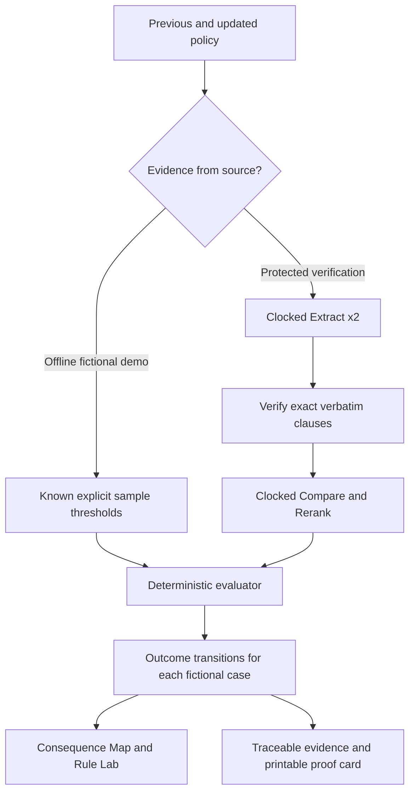

# Clocked API integration contract

**Official Python SDK:** [`clocked-sdk` 0.7.0](https://pypi.org/project/clocked-sdk/0.7.0/). The package is pinned in `requirements.txt`. Do not confuse it with the unrelated `clocked` Python package.

## Endpoints used

| Call | Source | Responsibility | Price trigger |
|---|---|---|---|
| Extract ×2 | `app/clocked_adapter.py` | Read verbatim minimum GPA and maximum annual household income from each policy | Protected live analysis only |
| Compare ×1 | `app/clocked_adapter.py` | Return cross-version duplicate/conflict verdicts | Protected live analysis only |
| Rerank ×1 | `app/clocked_adapter.py` | Rank the four extracted rule excerpts for relevance | Protected live analysis only |
| Compare PDF ×1 | `app/clocked_pdf.py` | Use text-mode PDFs with `return_pdf="highlight"` and only save the SDK's actual marked PDFs | Separate protected PDF-proof test only |

**Clocked is not a full rule compiler.** The custom, deterministic `app/rules.py` evaluates the two-source verified thresholds. If requirements are missing, ambiguous, or unsupported, the applicant is marked for review. The browser Rule Lab uses the same transparent logic for hypothetical changes but *never* claims the result was endorsed by Clocked.

## Flow

## Verification of live data

- `GET /api/health` intentionally declares `live_enabled: false` to the public because there is no public budget-backed live service.
- Protected `POST /api/internal/verify-clocked` invokes four real requests on **synthetic text only** if `ENABLE_VERIFICATION`, `RIPPLE_VERIFY_TOKEN`, and `RIPPLE_VERIFY_UNTIL` are set and an authorized owner submits the matching `X-Ripple-Verify` header.
- Protected `POST /api/internal/pdf-proof` invokes one further real Compare request on the two bundled synthetic PDFs and returns a ZIP containing a manifest and marked PDFs only when the SDK returns genuine bytes.
- **Do not leave these endpoints enabled for the public hackathon demo.** They are temporary verification tools, not part of the ordinary judge flow.

**Before a real run:** obtain user approval for the expected four calls (plus one optional PDF Compare), confirm remaining credits through Clocked's account dashboard, use a short token expiry, and disable the verification flag promptly. The app never reads or prints the Clocked API secret.

**After a real run:** record the sanitized endpoint names, exact date, field shapes, success/ambiguity status, and SDK-reported credits in `docs/VERIFICATION_RESULTS.md`. Do not replace failed responses with fabricated success.